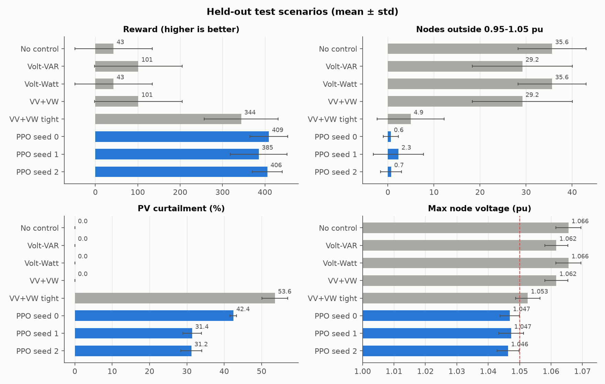
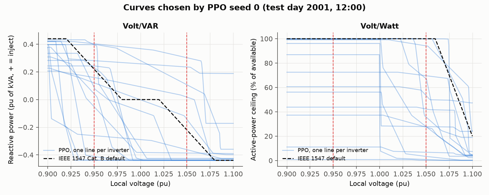
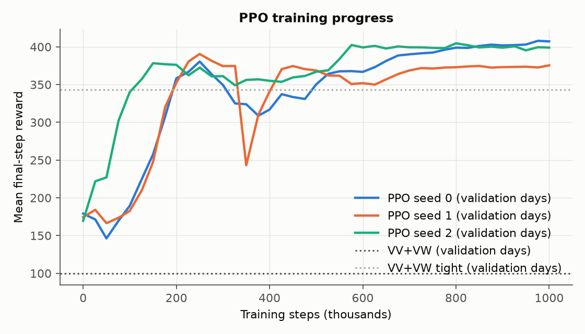
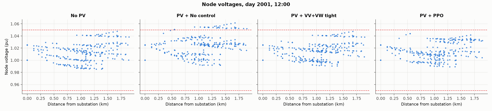
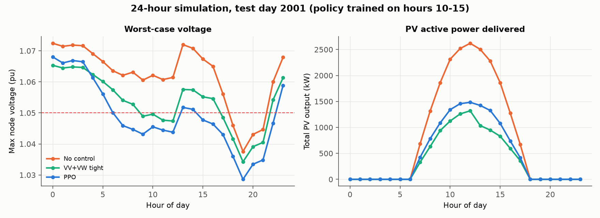

# PPO-tuned Volt/VAR and Volt/Watt control for PV inverters

Reinforcement learning (PPO) that learns per-inverter **Volt/VAR** and **Volt/Watt** curves
for 15 rooftop-scale PV systems on the **IEEE 123-node test feeder**, simulated in
**OpenDSS**. It is compared against standard IEEE 1547 curves and a hand-tuned curve on
identical held-out scenarios.



---

## Contents

- [Problem and motivation](#problem-and-motivation)
- [Feeder and PV setup](#feeder-and-pv-setup)
- [The RL environment](#the-rl-environment)
- [How PPO is used](#how-ppo-is-used)
- [Baselines](#baselines)
- [Results](#results)
- [Design choices](#design-choices)
- [Limitations](#limitations)
- [Installation](#installation)
- [Usage](#usage)
- [Project structure](#project-structure)

## Problem and motivation

When a lot of solar PV is installed on a distribution feeder, midday generation can exceed
local load. Power then flows back toward the substation and **raises voltage** along the
feeder, often above the ANSI C84.1 range of 0.95–1.05 pu. Utilities typically handle this
with inverter-based control defined in IEEE 1547-2018:

- **Volt/VAR**: the inverter absorbs reactive power when its terminal voltage is high and
  injects it when the voltage is low. This costs no energy but uses inverter capacity and
  increases losses.
- **Volt/Watt**: the inverter curtails active power when the voltage is high. This is very
  effective but throws away solar energy.

Both are defined by piecewise-linear **curves** (voltage breakpoints → Q or P). In practice
every inverter uses the same default curve, which is not tuned to where the inverter sits
on the feeder. This project asks whether an RL agent that sees the whole feeder can choose
**inverter-specific curves** that keep voltages in band while curtailing less solar than a
fixed curve does.

## Feeder and PV setup

| Item | Value |
|---|---|
| Network | IEEE 123-node test feeder, 4.16 kV, OpenDSS model vendored in [`data/ieee123`](data/ieee123) |
| Monitored nodes | 278 bus-phase nodes (all of them) |
| Voltage regulators | locked at tap +4 (+2.5 %), RegControls disabled, so inverters are the only active voltage control |
| PV systems | 15 single-phase, 5 per phase (buses 1, 8, 10, 11, 20 / 22, 39, 43, 48, 59 / 4, 6, 16, 17, 24) |
| PV rating | 200 kVA inverter, 180 kW array (2.7 MW fleet), reactive capability ±0.44 pu (IEEE 1547 Cat. B) |
| Load profile | 24-hour shape with evening peak, plus per-hour Gaussian noise |
| Irradiance | clear-sky sine (06:00–18:00) × daily clearness index U(0.7, 1.0) × 5 % per-PV noise |
| Scenarios | a "day" index seeds the random profiles. Days 1–500 are used for training, 1001–1005 for validation, 2001–2020 for testing, at hours 10:00–15:00 |

The high fixed regulator tap combined with midday PV causes **over-voltage** on most
scenarios when there is no control. The worst nodes reach about 1.065–1.07 pu.

## The RL environment

[`src/voltvar_rl/env.py`](src/voltvar_rl/env.py). An episode is one (day, hour) scenario,
solved as a quasi-static power flow.

**State (278-dim)**: the per-unit voltage magnitude of every node, normalised as
`(V − 1) / 0.05`, so the ANSI band maps to [−1, 1].

**Action (300-dim, in [−1, 1])**: for each of the 15 inverters, 20 numbers:

| Part | Size | Mapped to |
|---|---|---|
| Volt/VAR voltages | 5 | 0.90–1.10 pu, sorted ascending |
| Volt/VAR reactive power | 5 | ±0.44 pu of kVA, sorted descending (inject at low V, absorb at high V) |
| Volt/Watt voltages | 5 | 1.00–1.10 pu, sorted ascending |
| Volt/Watt power ceiling | 5 | 0–100 % of available power, sorted descending |

Sorting guarantees every action is a valid, standard-shaped curve.

**Transition**: each inverter reads its **local** voltage from the last power flow, looks up
its target Q and P ceiling on its own curves, and moves halfway toward them (damping 0.5,
like OpenDSS InvControl's `deltaQ_factor`). Q is limited by the kVA headroom left after P.
The power flow is then solved again **at the same hour**. Each episode has 10 such control
iterations, which is enough for the damped loop to converge.

**Reward** ([`reward.py`](src/voltvar_rl/reward.py)) is computed after every step from the
solved voltages and the **measured** PV output. Every strategy is scored with the same function:

```
reward =  2.0 · #nodes in 0.98–1.02 pu
       +  0.5 · #nodes in the rest of 0.95–1.05 pu
       − 100 · Σ under-voltage (pu)  − 150 · Σ over-voltage (pu)  − 5 · #violating nodes
       + (100 if no violations else 20) · P_PV / P_rated
       + 3 if std(V) < 0.01, 1.5 if std(V) < 0.02
       − 2.5 · Σ|Q_PV| / Q_capability
```

The reported metrics (violations, curtailment, max V, …) come from the **final** step of
each episode, after the control loop has converged.

## How PPO is used

[`src/voltvar_rl/ppo.py`](src/voltvar_rl/ppo.py), [`train.py`](src/voltvar_rl/train.py).

- **Policy**: Gaussian with a state-independent learnable std. The mean comes from a shared
  MLP (278 → 128 → 128) with a tanh head (→ 64 → 300). A value head (→ 64 → 1) shares the trunk.
- **Algorithm**: PPO clipped surrogate (ε = 0.2), GAE (γ = 0.99, λ = 0.95) with value
  bootstrapping at episode truncation, 2 000-step rollouts, 10 epochs of 256-sample
  minibatches, Adam (lr 3e-4), gradient clipping 0.5, rewards scaled by 0.01 for learning.
- **Training**: 1 000 000 environment steps (100 000 episodes, each a random training day
  and hour). This takes about **8 minutes on one CPU core** (an OpenDSS step is about 0.25 ms),
  so the reported results use the full run, not a shortened one. Three independent seeds
  (0, 1, 2) were trained in parallel, about 10.5 min each.
- **Model selection**: every 25 000 steps the deterministic policy (mean action) is scored
  on the validation days. The best checkpoint is kept and used for testing.
- **Reproducibility**: `seed` drives network initialisation, action sampling, the
  training-day sampler, numpy and torch (`torch.use_deterministic_algorithms`).
  `scenario_seed` (kept at 0) drives the load/irradiance profiles, so every training seed is
  validated and tested on identical scenarios. Retraining a seed gives identical weights. OpenDSS is solved with a 1e-10
  tolerance so results don't depend on solution history.

## Baselines

All baselines are **constant curves run through exactly the same environment** (same
scenarios, hours, inverter model, damping, iteration count, measurement and reward):

| Name | Volt/VAR | Volt/Watt |
|---|---|---|
| No control | off (unity power factor) | off |
| Volt-VAR | IEEE 1547 Cat. B default: (0.92, +0.44) (0.98, 0) (1.02, 0) (1.08, −0.44) | off |
| Volt-Watt | off | IEEE 1547 default: 100 % up to 1.06 pu, 20 % at 1.10 pu |
| VV+VW | both IEEE 1547 defaults | |
| VV+VW tight | steeper hand-tuned curves: VV ±0.44 over 0.95–1.05 pu, VW 100 % → 0 % over 0.98–1.05 pu | |

## Results

All numbers come from `python -m voltvar_rl evaluate` on **120 held-out test scenarios**
(test days 2001–2020 × hours 10:00–15:00), never seen in training or model selection.
Each strategy is measured after the 10th control iteration. Re-running the evaluation
reproduces [`results/metrics_per_scenario.csv`](results/metrics_per_scenario.csv) byte for byte.

**PPO across three training seeds**: each seed's mean over the 120 scenarios, then mean ±
sample std across the seeds ([`results/metrics_seeds.md`](results/metrics_seeds.md)):

| Strategy | Reward | Violating nodes | Violation-free scenarios | Max V (pu) | PV output (kW) | Curtailment | Σ abs Q (kvar) |
|---|---|---|---|---|---|---|---|
| VV+VW tight (best fixed curve) | 344.0 | 4.9 | 36 % | 1.0526 | 1002 | 53.6 % | 554 |
| PPO seed 0 | 409.3 | 0.6 | 81 % | 1.0469 | 1238 | 42.4 % | 926 |
| PPO seed 1 | 385.4 | 2.3 | 67 % | 1.0473 | 1481 | 31.4 % | 614 |
| PPO seed 2 | 405.9 | 0.7 | 88 % | 1.0463 | 1483 | 31.2 % | 865 |
| **PPO, mean ± std (3 seeds)** | **400.2 ± 12.9** | **1.2 ± 0.9** | **78 ± 11 %** | **1.0468 ± 0.0005** | **1401 ± 141** | **35.0 ± 6.4 %** | **802 ± 165** |

**All strategies**: mean ± std across the 120 scenarios
([`results/metrics_summary.md`](results/metrics_summary.md)). The fixed-curve baselines
are deterministic, so they have no seed variation.

| Strategy | Reward | Violating nodes | Violation-free scenarios | Max V (pu) | Min V (pu) | PV output (kW) | Curtailment | Σ abs Q (kvar) |
|---|---|---|---|---|---|---|---|---|
| No control | 42.8 ± 91.3 | 35.6 ± 7.4 | 0 % | 1.0655 | 0.9976 | 2154 | 0.0 % | 0 |
| Volt-VAR (IEEE 1547) | 101.3 ± 103.3 | 29.2 ± 10.8 | 0 % | 1.0617 | 0.9981 | 2154 | 0.0 % | 200 |
| Volt-Watt (IEEE 1547) | 42.8 ± 91.3 | 35.6 ± 7.4 | 0 % | 1.0655 | 0.9976 | 2154 | 0.0 % | 0 |
| VV+VW (IEEE 1547) | 101.3 ± 103.3 | 29.2 ± 10.8 | 0 % | 1.0617 | 0.9981 | 2154 | 0.0 % | 200 |
| VV+VW tight | 344.0 ± 87.1 | 4.9 ± 7.3 | 36 % | 1.0526 | 0.9969 | 1002 | 53.6 % | 554 |
| PPO seed 0 | 409.3 ± 44.5 | 0.6 ± 1.6 | 81 % | 1.0469 | 0.9966 | 1238 | 42.4 % | 926 |
| PPO seed 1 | 385.4 ± 66.8 | 2.3 ± 5.5 | 67 % | 1.0473 | 0.9987 | 1481 | 31.4 % | 614 |
| PPO seed 2 | 405.9 ± 35.4 | 0.7 ± 2.3 | 88 % | 1.0463 | 0.9985 | 1483 | 31.2 % | 865 |

**What this shows**

- **The IEEE 1547 defaults are too gentle for this stressed feeder.** Their Volt/VAR dead
  band (0.98–1.02 pu) and slope cut the worst voltage only from 1.066 to 1.062 pu. The
  default Volt/Watt curve never activates, because inverter terminal voltages stay below its
  1.06 pu knee even when other nodes exceed 1.05 pu. That's why Volt-Watt equals No control.
- **For all three seeds, PPO beats the best fixed curve on reward, violations, maximum
  voltage and delivered PV energy.** Averaged over seeds, it is violation-free in 78 ± 11 % of scenarios vs 36 %, and
  delivers **40 ± 14 % more PV energy** (curtailment 35 ± 6 % vs 54 %). Per scenario,
  PPO's reward beats the tight curves in 120, 93 and 86 of the 120 scenarios for seeds 0, 1
  and 2.
- **Seeds find different trade-offs.** Seed 0 curtails more (42 %) and uses the most
  reactive power. Seeds 1 and 2 curtail about 31 %. Seed 1 has the most residual
  violations. The validation reward used for checkpoint selection (408 / 391 / 405) ranks the
  seeds the same way as the test reward.
- **The price is reactive power.** PPO uses about 1.1–1.7× more |Q| than the tight curves,
  which in reality means more feeder losses and inverter loading. The reward penalises Q only
  weakly.
- **The learned curves are inverter-specific** (below, seed 0). Several inverters absorb
  close to their full 0.44 pu reactive capability across the normal operating range.
  Others hold a fixed active-power ceiling well below 100 %. This is location-aware
  behaviour that no single shared curve can express.
- **Later hours are hardest.** At 13:00–15:00 the tight curves never achieve a violation-free
  feeder (0/60 scenarios). PPO does in 37, 20 and 45 of 60 (seeds 0, 1, 2). Almost all of
  PPO's remaining violations are in these hours.

The single-scenario figures below (learned curves, voltage profile, 24-hour roll-out) use
the **seed-0** policy. The training curve shows all three seeds.

| | |
|---|---|
|  |  |

**Voltage profile** on test day 2001 at 12:00: node voltage vs. electrical distance from
the substation.



**24-hour roll-out** on test day 2001. The policy was trained only on 10:00–15:00. Early
morning and late evening violations occur even without PV (the regulators are locked at
+2.5 % and load is light), so no inverter strategy can remove all of them.



| Strategy (day 2001, 24 h) | PV energy | Hours with any violation |
|---|---|---|
| No control | 19 901 kWh | 20 |
| VV+VW tight | 9 369 kWh | 15 |
| PPO | 11 556 kWh | 10 |

## Design choices

| Choice | Setting | Why |
|---|---|---|
| Inverter damping | Every inverter moves 50 % of the way to its curve target per iteration (`env.damping: 0.5`). | Without damping, steep curves oscillate. For example, the tight VV+VW curve then makes the feeder's maximum voltage alternate between about 1.04–1.05 pu and 1.07 pu on successive iterations, and it never settles. The final metrics would depend on whether the last iteration lands on a peak or a trough. Real inverters respond with a time constant, and OpenDSS InvControl damps for the same reason. With 0.5, every strategy converges within the 10 iterations of an episode. 0.3 reaches the same fixed point more slowly, and 1.0 (no damping) oscillates. |
| Irradiance profile | A clear-sky sine between 06:00 and 18:00 peaking at noon, × a daily clearness index U(0.7, 1.0), × 5 % per-PV noise. | Solar output peaks around solar noon and is zero before sunrise, which puts peak PV at the time of the midday over-voltage this project is about. The clearness index makes days genuinely different, which matters because training, validation and test use different days. |
| Baselines | Constant 5-point curves applied by the same damped controller, in the same environment, as PPO. | A fair comparison should differ only in the curves. Running every strategy through one controller, with the same scenarios, hours, iteration count, power measurement and reward, isolates the effect of the curves. The trade-off: OpenDSS's built-in InvControl model is not used, so detailed IEEE 1547 response features (open-loop response time, reference-voltage auto-adjust) are not modelled. |
| PPO learning rate | 3e-4 | 3e-4 is the standard Adam learning rate for PPO. With per-minibatch advantage normalisation and reward scaling it learns stably within 1 M steps (see the training curve). Smaller rates such as 3e-5 were not tested. They may also work with a much larger step budget. |

The other PPO hyperparameters are common defaults: clip 0.2, γ 0.99, GAE λ 0.95, 10 epochs
of 256-sample minibatches, initial action std 0.2, no entropy bonus. Episodes have a fixed
length of 10 control iterations, and training samples from 500 random days × 6 hours.

## Limitations

- **Quasi-static, single-snapshot control.** Each episode is one hour, solved as a power flow.
  There are no dynamics, no hour-to-hour coupling and no regulator or capacitor operations.
  Within an episode the problem is close to a contextual bandit.
- **The policy is centralised.** It sees all 278 node voltages, but the curves it outputs
  are applied locally by each inverter. Deploying it would need a communication layer to
  push new curves (as in IEEE 1547's curve-setting interface).
- **Synthetic scenarios.** Load and irradiance are generated from simple parametric shapes
  with noise, not measured data. There are no clouds moving across the feeder and no
  realistic load diversity between buses (one multiplier for all loads).
- **Fixed regulators.** Locking all regulators at +2.5 % is a deliberate stress test. With
  working voltage regulation, many of these violations would not happen. Even with no PV,
  light-load hours exceed 1.05 pu, so some violations can't be removed by the inverters.
- **Reward-shaped objective.** "Better" here means a higher score on a hand-designed reward.
  It trades voltage quality, curtailed energy and reactive power with fixed weights, and
  the per-node voltage bonus dominates its scale. The other metrics are reported for that
  reason.
- **Training only at 10:00–15:00.** The 24-hour simulation shows how the policy behaves
  outside that window, but it was not trained there.
- **Only three seeds.** Seed-to-seed variation is visible (violation-free scenarios 67–88 %).
  Three seeds give a rough spread, not a confidence interval.

## Installation

Python 3.10+ (developed on 3.14, macOS). OpenDSS ships inside the `opendssdirect.py` wheel,
so no separate install is needed.

```bash
git clone https://github.com/Cagantibet/rl-volt-var-control.git
cd rl-volt-var-control
python -m venv .venv && source .venv/bin/activate
pip install -r requirements.txt
pip install -e .
pytest -q
```

## Usage

All commands accept `--config <yaml>` and any number of `--set section.key=value` overrides.

```bash
# Train PPO (writes runs/default/: checkpoints, training_log.csv, training_curve.png, config.yaml)
python -m voltvar_rl train
python -m voltvar_rl train --set seed=1 --out runs/seed1                     # another seed
python -m voltvar_rl train --set train.total_steps=100000 --out runs/quick   # quick run

# Validation curves of several runs in one figure
python -m voltvar_rl plot-training --run runs/seed0 --run runs/seed1 --out runs/training_curve.png

# Compare all baselines and PPO on the held-out test days
python -m voltvar_rl evaluate --model results/seed0/ppo_best.pt --model results/seed1/ppo_best.pt \
                             --model results/seed2/ppo_best.pt --out results

# Voltage-profile snapshot (no PV / no control / best baseline / PPO) for one scenario
python -m voltvar_rl profile --model results/seed0/ppo_best.pt --day 2001 --hour 12 --out results

# Run every hour of one day
python -m voltvar_rl simulate-day --model results/seed0/ppo_best.pt --day 2001 --out results
```

Omit `--model` to evaluate the baselines only. Pass several `--model` flags to compare seeds;
this also writes the across-seed table `metrics_seeds.md`.
[`scripts/reproduce.sh`](scripts/reproduce.sh) regenerates everything in `results/` from scratch
(3 seeds in parallel, about 15 min).

## Project structure

```
configs/default.yaml        every setting: feeder, PV fleet, profiles, curve ranges, reward
                            weights, PPO hyperparameters, scenario splits, seeds
data/ieee123/               OpenDSS IEEE 123-node model (vendored, BSD license) + provenance
src/voltvar_rl/
  config.py                 YAML → typed dataclasses, --set overrides
  feeder.py                 OpenDSS wrapper: compile, lock regulators, add PV, solve at an
                            hour, swap profiles, set inverter setpoints, measure V / P / Q
  profiles.py               seeded 24-h load and irradiance profiles for a (seed, day)
  curves.py                 5-point curve evaluation, action → valid curves, reference curves
  reward.py                 the single reward function
  env.py                    RL environment (reset(day, hour) / step(action))
  ppo.py                    actor-critic network, GAE, PPO update, seeding
  train.py                  training loop with validation-based checkpointing
  policies.py               fixed-curve baselines and the PPO policy wrapper
  evaluate.py               run strategies on scenarios, summary statistics, CSV/Markdown
  plotting.py               all figures
  cli.py                    command-line interface (python -m voltvar_rl ...)
tests/                      pytest suite (config, profiles, curves, reward, PPO, environment)
scripts/reproduce.sh        train 3 seeds + evaluate + figures, end to end
results/                    committed outputs: metrics, figures, training curve
  seed{0,1,2}/              trained model, training log and summary for each seed
```

## License

MIT (see [LICENSE](LICENSE)). The IEEE 123-node OpenDSS model in `data/ieee123/` is © EPRI
and DSS-Extensions contributors under its own BSD-style license.
